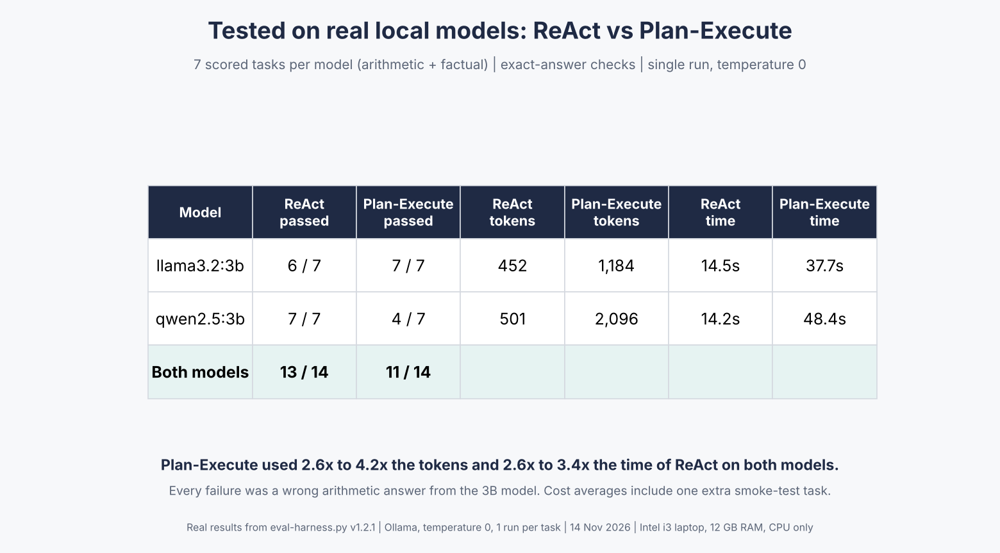
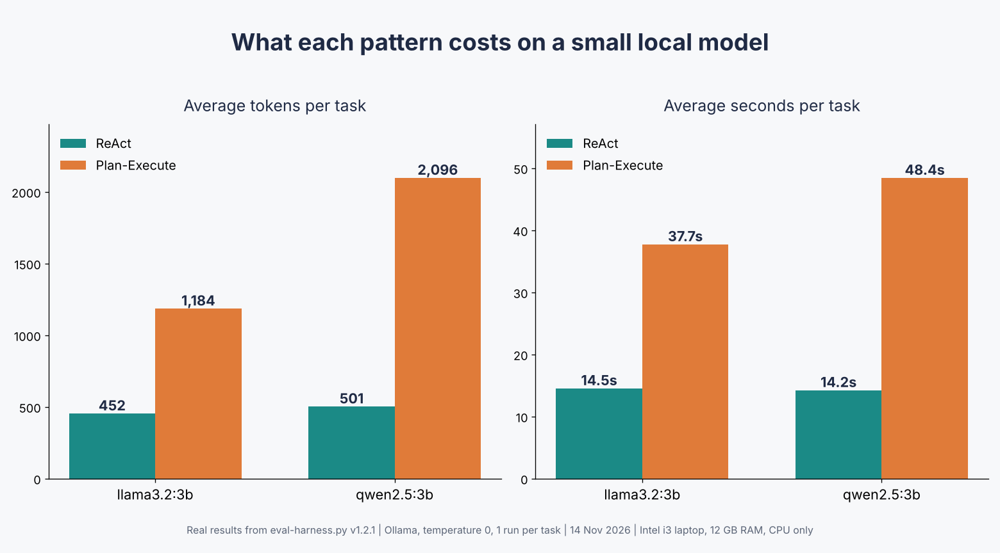
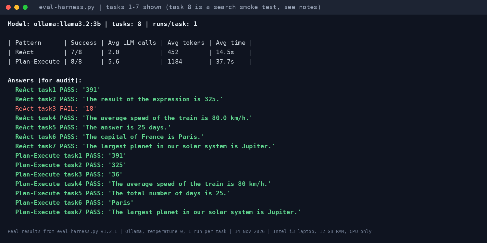
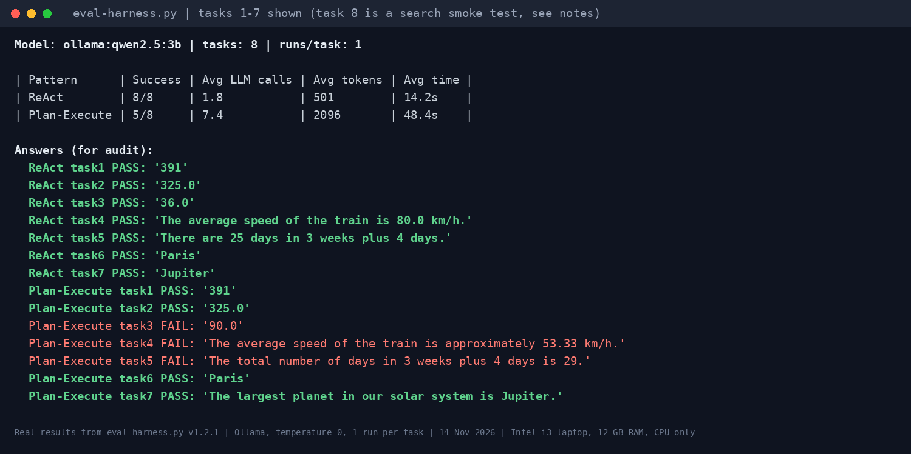

# Agentic AI Orchestration: Test Results

Open test results for **Agentic AI Orchestration**, a skill that helps AI coding agents design, build and test agents (ReAct loops, plan-and-execute, LangGraph, CrewAI, human approval gates, budgets).

This page shares what we measured, how we measured it, and what the numbers do **not** show. The skill itself is not in this repository.

- Video walkthrough (15 seconds): https://youtu.be/gRHhazfVgs0
- Skill listing: https://www.agensi.io/skills/agentic-ai-orchestration_

## Summary

We compared two agent patterns, **ReAct** (a tool loop) and **Plan-Execute** (plan first, then run each step), on two small local models running through Ollama.

| Model | ReAct passed | Plan-Execute passed | ReAct tokens | Plan-Execute tokens | ReAct time | Plan-Execute time |
|---|---|---|---|---|---|---|
| llama3.2:3b | 6 / 7 | 7 / 7 | 452 | 1,184 | 14.5s | 37.7s |
| qwen2.5:3b | 7 / 7 | 4 / 7 | 501 | 2,096 | 14.2s | 48.4s |
| Both models | 13 / 14 | 11 / 14 | | | | |

Token and time figures are averages per task over all 8 tasks (they include the search smoke test below).

## What we found

- **Plan-Execute cost more.** About 2.6x to 4.2x the tokens and 2.6x to 3.4x the time of ReAct, on both models. This is the clearest result.
- **Every failure was wrong arithmetic from a 3B model**, not a bug in the skill (llama ReAct answered 18 instead of 36; qwen Plan-Execute answered 90.0, 53.33 and 29 instead of 36, 80 and 25).
- **Neither pattern is shown to be more accurate in general.** Llama did slightly better with Plan-Execute, qwen did better with ReAct, and the samples are tiny.

## How we tested

- Harness: a small script that runs each task through both patterns and records success, LLM calls, tokens and time.
- Models: `llama3.2:3b` and `qwen2.5:3b` through Ollama.
- Settings: temperature 0, **one run per task** (repeating a task at temperature 0 gives the same answer).
- Hardware: Intel i3 laptop, 12 GB RAM, CPU only, Windows. Timings will differ on other machines.
- Date: 14 November 2026.
- Offline tests: 16 tests with scripted fake models passed before the live runs.

### Tasks

| # | Task | Expected answer |
|---|---|---|
| 1 | 17 x 23 | 391 |
| 2 | (1250 + 375) / 5 | 325 |
| 3 | 15% of 240 | 36 |
| 4 | Average speed: 120 km in 1.5 hours | 80 km/h |
| 5 | Days in 3 weeks plus 4 days | 25 |
| 6 | Capital of France | Paris |
| 7 | Largest planet in the solar system | Jupiter |
| 8 | Search for "langgraph checkpointer" and summarise | Smoke test only (not scored) |

Number answers are checked as whole numbers (so "360" does not count as "36"). Task 8 uses a stub search tool that only echoes the query, so it shows whether a tool gets called, not answer quality. It is excluded from the pass counts.

### Every answer, unedited

Plain-text copy: [answers.md](answers.md)

## Limits of this data

- Two small models only. Larger local models and hosted models were not tested.
- 7 scored tasks, one run each. A one-task difference is noise.
- Only ReAct and Plan-Execute were measured. Supervisor and crew patterns were not.
- Results are from one machine on one day.

If you build on this, run your own models and tasks. Small samples are a starting point, not a verdict.

---
Copyright (c) 2026 Zaheer Babar. The results and images may be quoted with a link back to this page. The skill itself is not included here and is sold separately under its own license.
